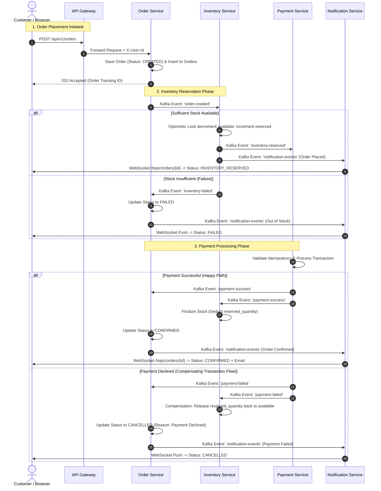
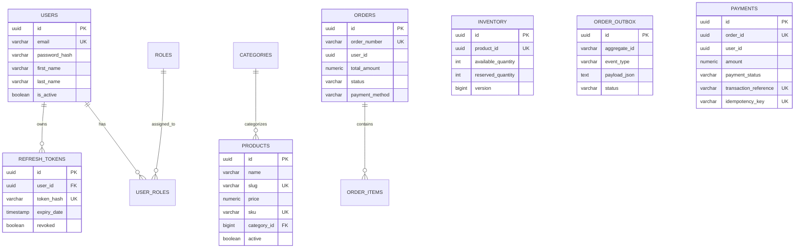

# ShopSphere – Event-Driven E-Commerce Microservices Platform

[](https://openjdk.org/projects/jdk/21/)
[](https://spring.io/projects/spring-boot)
[](https://spring.io/projects/spring-cloud)
[](https://kafka.apache.org/)
[](https://www.postgresql.org/)
[](https://redis.io/)
[](https://www.docker.com/)

ShopSphere is an enterprise-grade, distributed, event-driven e-commerce backend platform built using **Java 21**, **Spring Boot 3.3.x**, **Spring Cloud 2023.x**, **Apache Kafka (KRaft)**, **PostgreSQL (Database-per-Service)**, **Redis**, and **Docker**.

It demonstrates production-level distributed patterns including the **Choreography-based Saga Pattern**, the **Transactional Outbox Pattern** (solving the Dual-Write Problem), **JPA Optimistic Locking (`@Version`)** for high-concurrency stock reservation, **Stateless JWT + Refresh Token Rotation (RTR)**, **Resilience4j Circuit Breakers**, **Spring WebSocket with STOMP**, and **End-to-End Distributed Tracing via Micrometer & Zipkin**.

---

## 1. High-Level Architecture Overview

```mermaid
flowchart TD
    subgraph Clients["Client Layer"]
        Web["Single Page App (React/Vue)"]
        Mobile["Mobile App (Android/iOS)"]
    end

    subgraph Perimeter["Perimeter & Edge Gateway"]
        APIGW["Spring Cloud API Gateway :8080\n(JWT Validation, Redis Rate Limiting, CORS, Routing)"]
        Eureka["Eureka Discovery Server :8761\n(Service Registry & Health Checks)"]
        ConfigServer["Spring Cloud Config Server :8888\n(Centralized Configuration)"]
    end

    subgraph Services["Core Microservices Layer"]
        UserService["User Service :8081\n(Auth, RBAC, Profiles)"]
        ProductService["Product Service :8082\n(Catalog, Search, Categories)"]
        InventoryService["Inventory Service :8083\n(Stock Reservation, Optimistic Lock)"]
        CartService["Cart Service :8084\n(Shopping Cart, Session State)"]
        OrderService["Order Service :8085\n(Order Lifecycle, Saga Initiator)"]
        PaymentService["Payment Service :8086\n(Idempotent Mock Gateway)"]
        NotificationService["Notification Service :8087\n(Email Dispatch, WebSocket STOMP)"]
    end

    subgraph DataStorage["Persistence Layer (Database-per-Service)"]
        UserDB[("user_db\nPostgreSQL")]
        ProductDB[("product_db\nPostgreSQL")]
        InventoryDB[("inventory_db\nPostgreSQL")]
        CartRedis[("cart_cache\nRedis :6379")]
        OrderDB[("order_db\nPostgreSQL")]
        PaymentDB[("payment_db\nPostgreSQL")]
        NotificationDB[("notification_db\nPostgreSQL")]
    end

    subgraph Messaging["Distributed Event Bus"]
        Kafka["Apache Kafka Cluster :9092\n(Topics: order-created, inventory-reserved, payment-success, etc.)"]
        KafkaUI["Kafka UI :8090"]
    end

    subgraph Observability["Observability & Monitoring"]
        Zipkin["Zipkin / OpenTelemetry :9411\n(Distributed Tracing)"]
        Prometheus["Prometheus :9090\n(Metrics Collector)"]
        Grafana["Grafana :3000\n(Dashboards & Alerts)"]
    end

    %% Routing
    Clients -->|HTTPS REST| APIGW
    Clients -.->|WSS STOMP /ws| NotificationService
    APIGW --> UserService
    APIGW --> ProductService
    APIGW --> InventoryService
    APIGW --> CartService
    APIGW --> OrderService
    APIGW --> PaymentService
    APIGW --> NotificationService

    %% Persistence
    UserService --> UserDB
    ProductService --> ProductDB
    InventoryService --> InventoryDB
    CartService --> CartRedis
    OrderService --> OrderDB
    PaymentService --> PaymentDB
    NotificationService --> NotificationDB

    %% Kafka Events
    OrderService -->|Publish order-created| Kafka
    InventoryService <-->|Consume/Publish stock-events| Kafka
    PaymentService <-->|Consume/Publish payment-events| Kafka
    OrderService <--|Consume status updates| Kafka
    NotificationService <--|Consume domain events| Kafka
```

---

## 2. Microservice Registry & Ports

| Service | Port | Technology Stack | Responsibilities | Data Store |
| :--- | :--- | :--- | :--- | :--- |
| **Config Server** | `8888` | Spring Cloud Config Server | Centralized YAML configurations across environments (`native` profile). | File System / Classpath |
| **Discovery Server** | `8761` | Netflix Eureka Server | Standalone registry, heartbeat monitoring, and client-side load balancing. | In-Memory Registry |
| **API Gateway** | `8080` | Spring Cloud Gateway, WebFlux, Redis | Single entry point, JWT token validation, Redis Token Bucket rate limiting, CORS. | Redis (Rate Limiter) |
| **User Service** | `8081` | Spring Security, JJWT, BCrypt, JPA, Flyway | Identity management, registration, login, refresh token rotation, RBAC (`CUSTOMER`, `ADMIN`). | PostgreSQL (`user_db`) |
| **Product Service** | `8082` | Spring Data JPA, Redis, Flyway | Catalog, categories, GIN full-text search, pagination, multi-tier read caching. | PostgreSQL (`product_db`) + Redis |
| **Inventory Service** | `8083` | Spring Data JPA, Kafka, Flyway | Concurrency stock reservation using `@Version` Optimistic Locking, Saga step 2. | PostgreSQL (`inventory_db`) |
| **Cart Service** | `8084` | Spring Data Redis, OpenFeign, Resilience4j | In-memory shopping cart sessions (`cart:{userId}`), circuit breaker fallback, 72h TTL. | Redis (`cart_cache`) |
| **Order Service** | `8085` | Spring Data JPA, Kafka, OpenFeign, Flyway | Order placement, Transactional Outbox pattern, Saga coordination, state machine. | PostgreSQL (`order_db`) |
| **Payment Service** | `8086` | Spring Data JPA, Kafka, Flyway | Idempotent transaction processing (`idempotency_key`), mock gateway simulator, Saga step 3. | PostgreSQL (`payment_db`) |
| **Notification Service** | `8087` | Spring WebSocket, STOMP, Mail, Kafka, Flyway | Email alerts, STOMP WebSocket push (`/topic/orders/{orderId}`, `/user/queue/notifications`). | PostgreSQL (`notification_db`) |

---

## 3. Distributed Order-to-Payment Saga Workflow

ShopSphere implements a **Choreography-based Saga** with automated compensating transactions to maintain eventual consistency without distributed locking.



---

## 4. Database Design & Entity Relationship Diagram



---

## 5. REST API Documentation Catalog

### Authentication & Users
- `POST /api/v1/auth/register`: Create a new customer account.
- `POST /api/v1/auth/login`: Authenticate and receive an access token + rotated refresh token.
- `POST /api/v1/auth/refresh`: Exchange a valid refresh token for a fresh token pair.
- `POST /api/v1/auth/logout`: Invalidate the active refresh token.
- `GET /api/v1/users/me`: Retrieve current user profile.

### Product Catalog
- `GET /api/v1/products`: Faceted search and pagination (`?query=...&categoryId=...&page=0&size=10`).
- `GET /api/v1/products/{id}`: Product details (cached in Redis).
- `POST /api/v1/products`: Create a new product (`ADMIN` only).
- `PUT /api/v1/products/{id}`: Update product (`ADMIN` only).
- `DELETE /api/v1/products/{id}`: Soft-delete/deactivate product (`ADMIN` only).

### Inventory Management
- `GET /api/v1/inventory/{productId}`: Check real-time stock balance.
- `PUT /api/v1/inventory/{productId}`: Update available stock (`ADMIN` only).

### Shopping Cart (Redis Backed)
- `GET /api/v1/cart`: View current user's shopping cart.
- `POST /api/v1/cart/items`: Add item to cart or increment quantity.
- `PUT /api/v1/cart/items/{productId}`: Update item quantity.
- `DELETE /api/v1/cart/items/{productId}`: Remove item from cart.
- `DELETE /api/v1/cart`: Clear entire cart.

### Order Processing
- `POST /api/v1/orders`: Place order (initiates Saga via Transactional Outbox).
- `GET /api/v1/orders/{orderId}`: Get order details and current status.
- `GET /api/v1/orders/my-orders`: Get paginated customer order history.
- `PUT /api/v1/orders/{orderId}/cancel`: Cancel pending order.

### Payments
- `POST /api/v1/payments/process`: Direct payment charge (requires `Idempotency-Key` header).
- `GET /api/v1/payments/order/{orderId}`: Query transaction by order ID.

### Notifications & WebSocket
- `GET /api/v1/notifications`: Get notification history.
- `PUT /api/v1/notifications/{id}/read`: Mark notification as read.
- `PUT /api/v1/notifications/read-all`: Mark all notifications as read.
- **WebSocket Endpoint:** `/ws`
  - Order status updates: `/topic/orders/{orderId}`
  - Private user notifications: `/user/queue/notifications`

---

## 6. Quickstart & Deployment Guide

### Prerequisites
- **Java 21**
- **Maven 3.9+** (or Maven Wrapper `./mvnw`)
- **Docker & Docker Compose**

### 1. Configure Environment
```bash
cp .env.example .env
```

### 2. Start Middleware Infrastructure
```bash
# Launch PostgreSQL (multi-db), Redis, Kafka (KRaft), Kafka UI, Zipkin, Prometheus, and Grafana
docker compose up -d postgres redis kafka kafka-ui zipkin prometheus grafana
```

### 3. Build Multi-Module Project
```bash
mvn clean install
```

### 4. Build and Run Complete Application Stack via Docker
```bash
docker compose up --build -d
```

### 5. Access Dashboards
- **API Gateway Entrypoint:** `http://localhost:8080`
- **Eureka Service Registry:** `http://localhost:8761`
- **Kafka UI:** `http://localhost:8090`
- **Zipkin Distributed Tracing:** `http://localhost:9411`
- **Prometheus Console:** `http://localhost:9090`
- **Grafana Observability Dashboard:** `http://localhost:3000` (`admin` / `admin`)

---

## 7. Testing Strategy

### A. Unit Tests (JUnit 5 & Mockito)
Run unit tests across all microservices:
```bash
mvn test
```

### B. End-to-End Integration Tests (Testcontainers)
In `order-service`, the test [OrderWorkflowIntegrationTest.java](file:///A:/Sem%202/files/ShopSphere/order-service/src/test/java/com/shopsphere/order/e2e/OrderWorkflowIntegrationTest.java) spins up real containerized PostgreSQL and Kafka instances to verify the complete Saga workflow:
1. Inserts order and outbox records atomically in PostgreSQL.
2. Polls and publishes `OrderCreatedEvent` to Kafka.
3. Simulates payment callback and confirms order status transitions.

To run Testcontainers integration tests:
```bash
mvn test -Dtest=OrderWorkflowIntegrationTest
```

---

## 8. Senior Java Backend Architect Interview Q&A Deep Dive

### Q1: What is the Dual-Write Problem, and how did you solve it in ShopSphere?
> **Answer:**  
> The Dual-Write Problem occurs when a microservice needs to update a database and publish an event to a message broker within the same business operation. If either system fails or times out, the system enters an inconsistent state (Zombie Orders or Phantom Stock).  
> In ShopSphere, we solve this with the **Transactional Outbox Pattern**: the `Order` entity and an `OrderOutbox` record are written to PostgreSQL inside the **same local ACID transaction (`@Transactional`)**. An asynchronous background worker (`OutboxPublisherService`) polls pending records, sends them to Kafka with `acks=all`, and marks them as `PUBLISHED`. This guarantees **At-Least-Once Delivery** without distributed two-phase commits.

### Q2: Why use Optimistic Locking over Pessimistic Locking for inventory stock reservation?
> **Answer:**  
> Under high concurrency (such as flash sales), **Pessimistic Locking** (`SELECT ... FOR UPDATE`) acquires physical row-level locks in the database engine, forcing concurrent threads to block. This quickly exhausts the HikariCP connection pool, causes severe latency spikes, and introduces deadlock risks.  
> **Optimistic Locking** (`@Version`) avoids database locking entirely. Threads read the record version without blocking. During update, the SQL query executes `UPDATE inventory SET available = ..., version = version + 1 WHERE id = ? AND version = ?`. If another thread committed first, Hibernate throws `ObjectOptimisticLockingFailureException`. Paired with retry policies, this provides far higher throughput and prevents overselling under heavy load.

### Q3: Why did you choose Choreography-based Saga over Orchestration-based Saga?
> **Answer:**  
> In Choreography, each microservice consumes domain events and independently decides its business actions and compensations. There is no central orchestrator acting as a single point of failure or throughput bottleneck. For our 4-step workflow (Order $\rightarrow$ Inventory $\rightarrow$ Payment $\rightarrow$ Notification), choreography provides optimal simplicity and high performance.

### Q4: How is Idempotency guaranteed across asynchronous Kafka consumers?
> **Answer:**  
> Kafka provides **At-Least-Once Delivery**. Network blips during consumer offset commits can cause messages to be re-delivered.  
> In ShopSphere, every event envelope carries an immutable `eventId` (UUID). Consumers insert the `eventId` into a `processed_events` table inside the same local database transaction that executes the business logic. If a duplicate arrives, the database unique constraint raises a collision, and the consumer immediately acknowledges the Kafka offset without re-executing the payment or stock deduction.

### Q5: Why is Redis preferred over PostgreSQL for shopping carts?
> **Answer:**  
> Over 70% of e-commerce shopping carts are abandoned. Storing carts in a relational disk-based database causes high I/O churn, index fragmentation, and requires scheduled batch cleanup scripts. Redis operates in RAM with sub-millisecond latencies ($< 1\text{ ms}$) and provides native key expiration via `SETEX cart:{userId} 259200`. Idle carts expire naturally after 72 hours with zero operational maintenance.

### Q6: How does Distributed Tracing correlate logs across synchronous REST and asynchronous Kafka events?
> **Answer:**  
> Synchronous calls propagate tracing via HTTP headers (`traceparent`, `X-Correlation-Id`) using `FeignCorrelationInterceptor`.  
> Across asynchronous Kafka queues, **Micrometer Tracing** automatically injects trace context into Kafka's binary **Record Headers**. When the consumer receives the record, it extracts the trace header and resumes the span as a child span of the original trace. This ensures that a single distributed `traceId` ties together the initial API Gateway request, the Order Service database insert, the Kafka event, and the Payment Service execution in Zipkin.

---

## 9. Kubernetes & Production Cloud Deployment

While Docker Compose is used for local rapid prototyping, ShopSphere includes enterprise Kubernetes manifests under `infrastructure/k8s/`:

```bash
# 1. Create the dedicated namespace
kubectl apply -f infrastructure/k8s/namespace.yaml

# 2. Deploy ConfigMaps and Secrets
kubectl apply -f infrastructure/k8s/configmap.yaml
kubectl apply -f infrastructure/k8s/secrets.yaml

# 3. Provision Middleware & Databases
kubectl apply -f infrastructure/k8s/postgres.yaml
kubectl apply -f infrastructure/k8s/redis.yaml
kubectl apply -f infrastructure/k8s/kafka.yaml
kubectl apply -f infrastructure/k8s/observability.yaml

# 4. Deploy Core Microservices & API Gateway
kubectl apply -f infrastructure/k8s/apps-infra.yaml
kubectl apply -f infrastructure/k8s/apps-core.yaml
kubectl apply -f infrastructure/k8s/ingress.yaml
kubectl apply -f infrastructure/k8s/hpa.yaml
```

---

## 10. Automated End-to-End Verification & Postman

### Running the End-to-End Platform Verification Suite
We provide native automated scripts that register a user, authenticate via JWT, create a product, seed inventory, add to cart, trigger the choreographed Saga checkout, and poll until the order reaches `CONFIRMED`:

```powershell
# Windows PowerShell:
.\scripts\verify-platform.ps1

# Linux / macOS / CI:
chmod +x scripts/verify-platform.sh
./scripts/verify-platform.sh
```

### Importing Postman Collection
Import `docs/api/shopsphere-postman-collection.json` into Postman. It contains pre-configured requests, environment variables, and auto-token extraction scripts for all 10 microservices.

---

## 11. Project Multi-Module Directory Tree

```text
ShopSphere/
├── pom.xml                                   # Root Multi-Module Parent POM
├── mvnw & mvnw.cmd                           # Portable Maven Wrapper scripts
├── docker-compose.yml                        # Full 17-container deployment stack
├── .env.example                              # Shared environment variables template
├── .github/workflows/ci.yml                  # GitHub Actions CI/CD Pipeline
├── README.md                                 # Master documentation
├── docs/
│   ├── api/
│   │   └── shopsphere-postman-collection.json# Full Postman Collection with Auto-Auth
│   └── architecture/
│       ├── system-design.md                  # System architecture blueprint
│       └── saga-pattern-deep-dive.md         # Distributed transactions & interview guide
├── scripts/
│   ├── verify-platform.ps1                   # Automated E2E Saga verification (PowerShell)
│   └── verify-platform.sh                    # Automated E2E Saga verification (Bash)
├── infrastructure/
│   ├── docker/
│   │   ├── postgres/init-multiple-dbs.sh     # Multi-database init script
│   │   ├── prometheus/prometheus.yml         # Prometheus scrape configuration
│   │   └── grafana/provisioning/             # Grafana datasource and dashboard provisioning
│   └── k8s/                                  # Production Kubernetes Manifests
│       ├── namespace.yaml                    # Dedicated 'shopsphere' namespace
│       ├── configmap.yaml & secrets.yaml     # Central K8s configs & credentials
│       ├── postgres.yaml                     # StatefulSet + PersistentVolumeClaims
│       ├── redis.yaml & kafka.yaml           # Middleware Deployments & Services
│       ├── observability.yaml                # Prometheus & Zipkin K8s manifests
│       ├── apps-infra.yaml                   # Config Server, Eureka, API Gateway
│       ├── apps-core.yaml                    # 7 Core Microservices with Probes
│       ├── ingress.yaml                      # NGINX Ingress rules
│       └── hpa.yaml                          # Horizontal Pod Autoscaling (Order & Product)
├── shopsphere-common/                        # Shared DTOs, Kafka Events, Exceptions, Tracing
├── config-server/                            # Spring Cloud Config Server (:8888)
├── discovery-server/                         # Netflix Eureka Service Registry (:8761)
├── api-gateway/                              # Spring Cloud Gateway & Security Perimeter (:8080)
├── user-service/                             # Identity, Auth & RBAC Service (:8081)
├── product-service/                          # Catalog, Categories & Redis Caching (:8082)
├── inventory-service/                        # Stock Reservation & Optimistic Locking (:8083)
├── cart-service/                             # Redis-backed Shopping Cart Service (:8084)
├── order-service/                            # Order Lifecycle, Outbox & Saga Initiator (:8085)
├── payment-service/                          # Idempotent Payment Gateway & Saga Compensation (:8086)
└── notification-service/                     # Email Dispatch & STOMP WebSocket Service (:8087)
```
