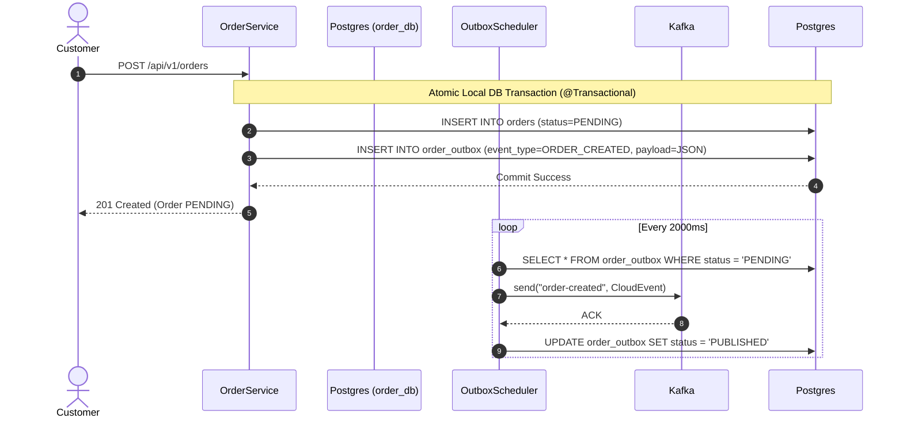
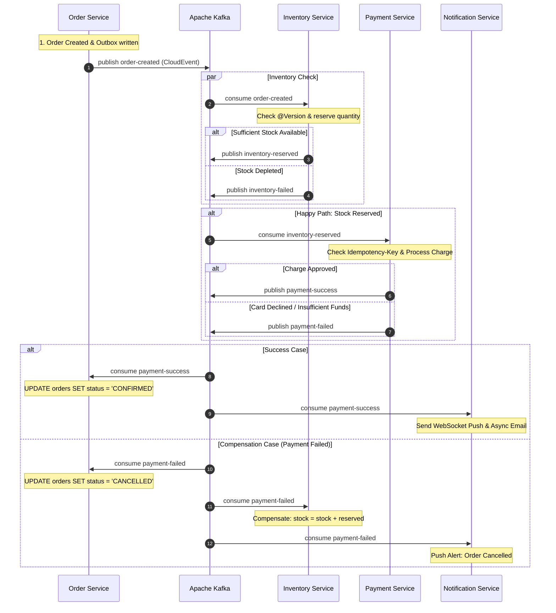

# ShopSphere: Saga Pattern & Distributed Transactions Deep Dive

## 1. The Distributed Transactions Problem in Microservices

In a monolithic architecture, placing an order involves modifying multiple tables within a single relational database:
```sql
BEGIN TRANSACTION;
INSERT INTO orders ...;
UPDATE inventory SET available_quantity = available_quantity - 2 WHERE product_id = 101;
INSERT INTO payments ...;
COMMIT;
```
ACID properties are guaranteed by the database engine's write-ahead log (WAL) and two-phase locking.

In a **Database-per-Service Microservices Architecture**, data is distributed across physical databases:
- `OrderService` owns `order_db`
- `InventoryService` owns `inventory_db`
- `PaymentService` owns `payment_db`

A single atomic database transaction across these boundaries is impossible without distributed transaction protocols like **Two-Phase Commit (2PC)** or **XA Transactions**.

### Why 2PC/XA Is an Anti-Pattern in Modern Cloud-Native Systems:
1. **Coordinator as Single Point of Failure (SPOF):** If the coordinator crashes during the prepare phase, resource managers hold row locks indefinitely.
2. **Blocking Latency & Throughput Collapse:** Locks are held across network round-trips ($O(N)$ network latency), plummeting throughput under high concurrency.
3. **Incompatibility with NoSQL / Message Brokers:** Technologies like Redis, Kafka, and DynamoDB do not support XA protocols.
4. **CAP Theorem Violation:** 2PC favors Consistency over Availability (CP), rendering the entire platform unavailable if a single microservice database is unreachable.

---

## 2. The Saga Pattern: Definition & Mechanism

A **Saga** is a sequence of local transactions $T_1, T_2, \dots, T_n$. Each local transaction $T_i$ updates data within a single service and publishes an event or message that triggers the next local transaction $T_{i+1}$.

If a local transaction $T_k$ fails (e.g., payment declined or insufficient stock), the Saga executes a series of **Compensating Transactions** $C_{k-1}, \dots, C_1$ in reverse order to undo the changes made by earlier transactions.

### Key Characteristics:
- **ACID $\rightarrow$ BASE:**
  - **Basically Available:** Each service operates independently.
  - **Soft State:** State transitions occur over time (e.g., `PENDING` $\rightarrow$ `CONFIRMED`).
  - **Eventually Consistent:** Compensations guarantee consistency once all events are consumed.
- **Semantic Rollback:** Unlike DB rollback (which discards dirty pages), compensating transactions are new forward transactions that invert business effects (e.g., refunding a charge or releasing reserved stock).

---

## 3. Choreography vs. Orchestration: Architectural Comparison

| Dimension | Choreography (Implemented in ShopSphere) | Orchestration (Temporal / Camunda / State Machine) |
| :--- | :--- | :--- |
| **Coordination** | Decentralized via Kafka domain events | Centralized Saga Orchestrator service |
| **Coupling** | Loose coupling; services subscribe to topics | High coupling to the orchestrator interface |
| **Single Point of Failure** | None (Kafka broker is distributed) | The Orchestrator engine can become a bottleneck |
| **Complexity** | Simple for 3–5 step workflows; tracking state across services requires correlation IDs | Easy to visualize complex branching logic in a single coordinator |
| **Best Used When** | Fast, high-throughput e-commerce checkouts | Complex enterprise workflows (30+ steps, manual approvals) |

---

## 4. Solving the Dual-Write Problem with Transactional Outbox

When `OrderService` creates an order, it must perform two actions:
1. Write the new order to `order_db`
2. Publish `order-created` event to Apache Kafka



### Why direct Kafka publishing inside `@Transactional` is catastrophic:
- If `kafkaTemplate.send()` succeeds but `orderRepository.save()` fails during DB commit $\rightarrow$ **Phantom Event** (Inventory is reserved for an order that does not exist).
- If DB commit succeeds but Kafka broker is temporarily down $\rightarrow$ **Lost Event** (Order is stuck in `PENDING` forever).
- **The Outbox Pattern guarantees At-Least-Once event publication without distributed locks.**

---

## 5. End-to-End Choreographed Saga Flow in ShopSphere



---

## 6. High-Frequency Concurrency: Optimistic vs. Pessimistic Locking

In flash-sale events (e.g., 5,000 requests/second for 100 PlayStation units), naive updates result in race conditions.

### Pessimistic Locking (`SELECT ... FOR UPDATE`):
```sql
SELECT * FROM inventory WHERE product_id = 101 FOR UPDATE;
```
- **Drawback:** Holds exclusive row lock for the entire duration of the transaction.
- Under high load, connection pools (HikariCP) saturate, threads block in `WAITING` state, cascading timeouts ripple through the API Gateway.

### Optimistic Locking with `@Version` (Implemented in ShopSphere):
```java
@Entity
@Table(name = "inventory")
public class Inventory {
    @Id
    private Long id;
    private Integer availableQuantity;
    private Integer reservedQuantity;
    @Version
    private Long version;
}
```
- Hibernate automatically appends version validation to the SQL update:
```sql
UPDATE inventory 
SET available_quantity = ?, reserved_quantity = ?, version = version + 1 
WHERE id = ? AND version = ?;
```
- If another thread modified the row concurrently, zero rows are updated, and Hibernate throws `OptimisticLockingFailureException`.
- **Mitigation:** Caught and retried with exponential backoff using Resilience4j `@Retry(name = "inventoryRetry")`.

---

## 7. Senior Architect Interview Defense & Mastery Guide

### Q1: "How do you handle duplicate events arriving at a Saga consumer under Kafka's At-Least-Once semantics?"
**Architect Answer:**
"Kafka guarantees at-least-once delivery, which means network blips or consumer rebalances can cause a consumer to re-read an offset. In ShopSphere, every domain event implements `BaseEvent<T>` containing a unique RFC 4122 `eventId`. 
In both `inventory-service` and `payment-service`, we implement the **Idempotent Consumer Pattern** using a dedicated `processed_events` table with a primary key constraint on `event_id`. When a consumer receives an event, it executes the business logic and inserts into `processed_events` within the same local `@Transactional` block. If a duplicate arrives, the unique constraint violation (`DataIntegrityViolationException`) aborts the transaction cleanly without duplicate stock deduction or double billing."

### Q2: "What happens if the Outbox Scheduler crashes while publishing events?"
**Architect Answer:**
"The outbox table contains a status column (`PENDING`, `PUBLISHED`, `FAILED`) and a `created_at` timestamp. When the outbox scheduler restarts, it queries for rows where `status = 'PENDING'`. Because the status update to `PUBLISHED` only occurs after the Kafka producer returns an acknowledgement (`RecordMetadata` future completes), any unacknowledged events are re-published. Because our downstream consumers are strictly idempotent, at-least-once outbox publishing ensures zero message loss with zero duplicate side effects."

### Q3: "How do you prevent a Poison Pill message from blocking a Kafka partition?"
**Architect Answer:**
"A poison pill is a corrupted payload or unparseable JSON that throws an unrecoverable exception on deserialization. If not handled, the consumer will continually fail and retry, stalling partition processing. In Spring Kafka, we configure an `ErrorHandlingDeserializer` paired with a `DefaultErrorHandler` and a `DeadLetterPublishingRecoverer` (DLT). After 3 retry attempts with exponential backoff (1s, 2s, 4s), the message is routed to `.DLT` (e.g., `order-created.DLT`) and the consumer commits the offset to resume processing healthy events. The DLT topic triggers an alert in Grafana for SRE investigation."

### Q4: "Why did you choose Choreography over an Orchestrator like Temporal or Camunda for ShopSphere?"
**Architect Answer:**
"We evaluated both. For an e-commerce checkout flow with 4 distinct bounded contexts (Order $\rightarrow$ Inventory $\rightarrow$ Payment $\rightarrow$ Notification), Choreography offers maximum throughput, zero single points of failure, and minimal operational overhead. Introducing a central orchestrator requires maintaining a separate state machine cluster, schema migrations for orchestrator tables, and synchronous RPC invocations that couple services. If our workflow grew to 20+ steps with human-in-the-loop approvals, credit bureau integrations, and fraud review pauses, we would introduce an orchestrator. For high-volume e-commerce, reactive Kafka choreography is the gold standard."
