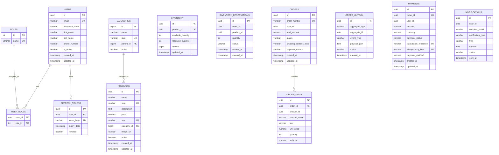
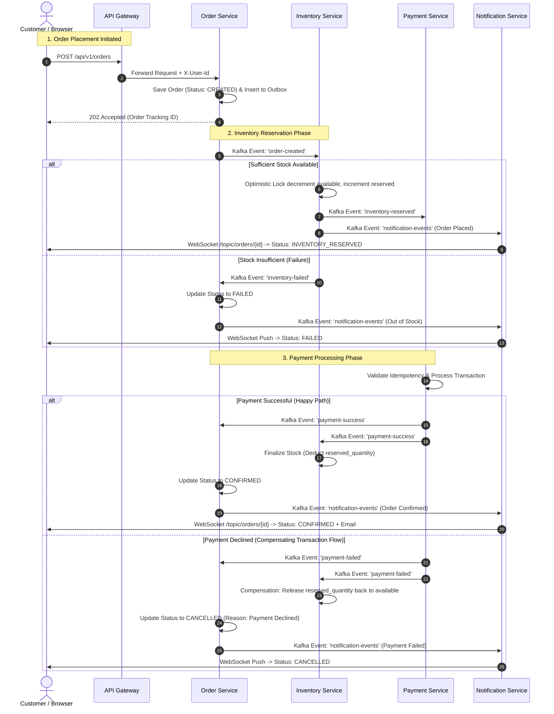
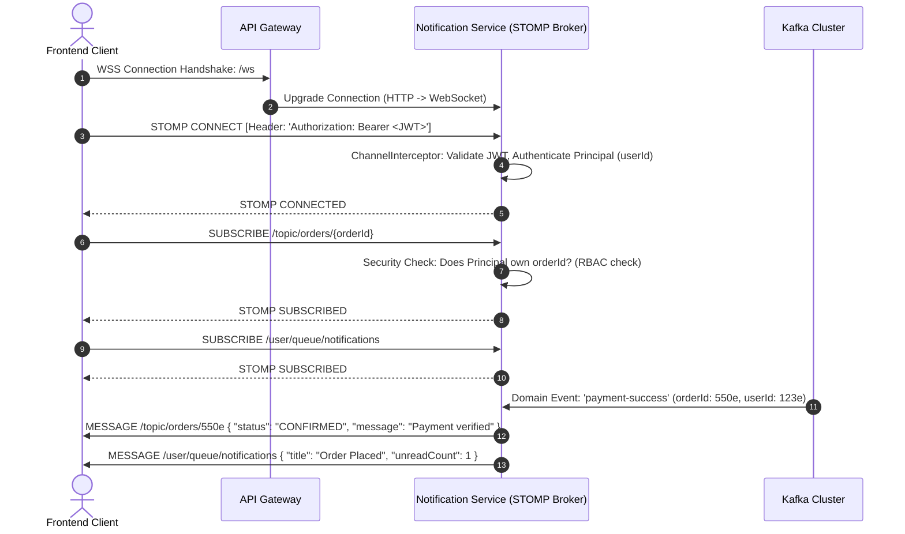
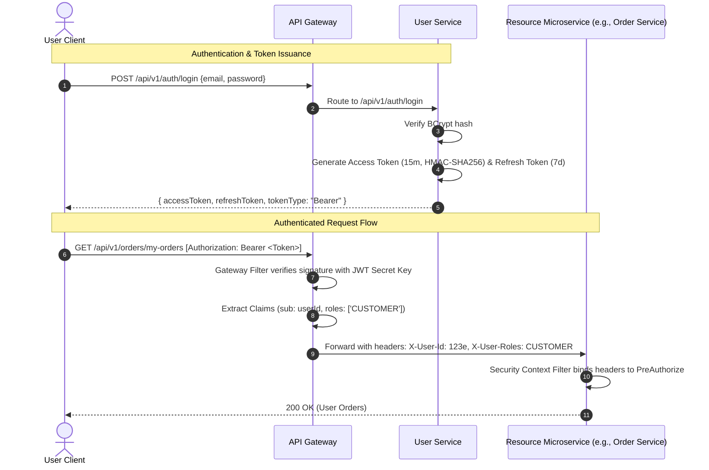

# ShopSphere – Event-Driven E-Commerce Microservices Platform
## Phase 1: High-Level and Low-Level System Architecture Specification

---

### 1. Executive Summary & Architectural Tenets
**ShopSphere** is an enterprise-grade, distributed, event-driven e-commerce platform engineered using Java 21, Spring Boot 3.3.x, Spring Cloud 2023.x, Apache Kafka, PostgreSQL, Redis, and Docker.

#### Core Architectural Tenets:
1. **Domain-Driven Design (DDD) & Bounded Contexts:** Every microservice encapsulates a distinct business domain with its own data store (Database-per-Service). Direct cross-database joins are prohibited.
2. **Event-Driven Architecture (EDA) & Eventual Consistency:** Cross-service transaction workflows rely on asynchronous message queues (Apache Kafka) utilizing the Saga Pattern. Synchronous HTTP (OpenFeign) is strictly reserved for non-mutating queries or instant read snapshots.
3. **Zero-Trust Edge Security:** The API Gateway acts as the policy enforcement point, terminating perimeter traffic, validating JWTs, rate-limiting malicious bursts, and forwarding sanitized identity claims (`X-User-Id`, `X-User-Roles`) to downstream services.
4. **Resilience & Fault Isolation:** Failures in auxiliary services (e.g., Notification or Payment) must never cascade to core catalog browsing or order placement. Circuit breakers, bulkheads, rate limiters, and dead-letter queues safeguard system availability.
5. **Full Observability & Idempotency:** Every transaction carries a distributed Correlation ID (`X-Correlation-Id`), enabling seamless end-to-end tracing through Micrometer, Zipkin, and Prometheus. All event consumers enforce strict idempotency to handle network retries gracefully.

---

### 2. High-Level System Architecture

```mermaid
flowchart TD
    subgraph Clients["Client Layer"]
        SPA["Single Page App (React/Vue)"]
        Mobile["Mobile App (Android/iOS)"]
        AdminWeb["Admin Portal"]
    end

    subgraph Perimeter["Perimeter & Edge Gateway"]
        APIGW["Spring Cloud API Gateway\n:8080\n(JWT Validation, Rate Limiter, CORS, Routing)"]
        Eureka["Eureka Discovery Server\n:8761\n(Service Registry & Health Check)"]
        ConfigServer["Spring Cloud Config Server\n:8888\n(Centralized Environment Config)"]
    end

    subgraph Services["Core Microservices Layer"]
        UserService["User Service\n:8081\n(Auth, RBAC, Profiles)"]
        ProductService["Product Service\n:8082\n(Catalog, Search, Categories)"]
        InventoryService["Inventory Service\n:8083\n(Stock Reservation, Optimistic Lock)"]
        CartService["Cart Service\n:8084\n(Shopping Cart, Session State)"]
        OrderService["Order Service\n:8085\n(Order Lifecycle, Saga Initiator)"]
        PaymentService["Payment Service\n:8086\n(Idempotent Mock Gateway)"]
        NotificationService["Notification Service\n:8087\n(Email Dispatch, WebSocket STOMP)"]
    end

    subgraph DataStorage["Persistence Layer (Database-per-Service)"]
        UserDB[("user_db\nPostgreSQL")]
        ProductDB[("product_db\nPostgreSQL")]
        InventoryDB[("inventory_db\nPostgreSQL")]
        CartRedis[("cart_cache\nRedis:6379")]
        OrderDB[("order_db\nPostgreSQL")]
        PaymentDB[("payment_db\nPostgreSQL")]
        NotificationDB[("notification_db\nPostgreSQL")]
    end

    subgraph Messaging["Distributed Event Bus"]
        Kafka["Apache Kafka Cluster :9092\n(Topics: order-created, inventory-reserved, payment-success, etc.)"]
        KafkaUI["Kafka UI :8090"]
    end

    subgraph Observability["Observability & Monitoring"]
        Zipkin["Zipkin / OpenTelemetry :9411\n(Distributed Tracing)"]
        Prometheus["Prometheus :9090\n(Metrics Scraper)"]
        Grafana["Grafana :3000\n(Dashboards & Alerts)"]
    end

    %% Client Traffic
    Clients -->|HTTPS REST| APIGW
    Clients -.->|WSS STOMP /ws| NotificationService

    %% Gateway to Services
    APIGW -->|Route /api/v1/auth/**| UserService
    APIGW -->|Route /api/v1/products/**| ProductService
    APIGW -->|Route /api/v1/inventory/**| InventoryService
    APIGW -->|Route /api/v1/cart/**| CartService
    APIGW -->|Route /api/v1/orders/**| OrderService
    APIGW -->|Route /api/v1/payments/**| PaymentService
    APIGW -->|Route /api/v1/notifications/**| NotificationService

    %% Service Discovery & Config
    Services -.->|Heartbeat / Lookup| Eureka
    Services -.->|Fetch Properties| ConfigServer
    APIGW -.-> Eureka
    APIGW -.-> ConfigServer

    %% Persistence Bindings
    UserService --> UserDB
    ProductService --> ProductDB
    InventoryService --> InventoryDB
    CartService --> CartRedis
    OrderService --> OrderDB
    PaymentService --> PaymentDB
    NotificationService --> NotificationDB

    %% Event-Driven Bus Connections
    OrderService -->|Publish Order Events| Kafka
    InventoryService <-->|Consume/Publish Stock Events| Kafka
    PaymentService <-->|Consume/Publish Payment Events| Kafka
    OrderService <--|Consume State Updates| Kafka
    NotificationService <--|Consume Domain Events| Kafka

    %% Observability Scraping
    Services -.->|Push Traces| Zipkin
    Services -.->|Scrape Actuator /metrics| Prometheus
    Prometheus --> Grafana
```

---

### 3. Microservice Bounded Contexts & Responsibilities

| Service | Port | Primary Responsibilities | Data Store | Key Dependencies |
| :--- | :--- | :--- | :--- | :--- |
| **Config Server** | 8888 | Externalizes application properties across environments (`dev`, `prod`). Supports dynamic refresh via Spring Cloud Bus / Actuator. | Git / Native File System | Spring Cloud Config |
| **Eureka Server** | 8761 | Service registration, heartbeat monitoring, and dynamic client-side load balancing resolution. | In-Memory Registry | Netflix Eureka Server |
| **API Gateway** | 8080 | Single entry point. Reverse proxy, JWT signature and expiry validation, token-bucket rate limiting via Redis, CORS, routing. | Redis (Rate Limiting) | Spring Cloud Gateway, Reactive Redis |
| **User Service** | 8081 | Identity management, BCrypt hashing, JWT issuance & refresh token rotation, user profile, RBAC (`CUSTOMER`, `ADMIN`). | PostgreSQL (`user_db`) | Spring Security, JJWT, Spring Data JPA |
| **Product Service** | 8082 | Product catalog, hierarchical categories, search, filtering, pagination, SKU management, read-heavy caching. | PostgreSQL (`product_db`) + Redis | Spring Data JPA, Redis Cache |
| **Inventory Service** | 8083 | Real-time stock tracking, reservation allocation, compensation releases, concurrency safety via Optimistic Locking (`@Version`). | PostgreSQL (`inventory_db`) | Spring Data JPA, Kafka |
| **Cart Service** | 8084 | Ephemeral shopping cart state, item mutations, subtotal calculations. Cleared upon order placement. | Redis (`cart_cache`) | Spring Data Redis |
| **Order Service** | 8085 | Order placement, unique ID generation, state machine transitions, Transactional Outbox pattern, Saga orchestration initiator. | PostgreSQL (`order_db`) | Spring Data JPA, Kafka, OpenFeign |
| **Payment Service** | 8086 | Idempotent transaction processing, mock payment provider integration, webhook simulation, payment auditing. | PostgreSQL (`payment_db`) | Spring Data JPA, Kafka |
| **Notification Service** | 8087 | Asynchronous email dispatch, STOMP WebSocket broker endpoint `/ws`, private user channels (`/user/queue/notifications`). | PostgreSQL (`notification_db`) | Spring WebSocket, STOMP, Mail, Kafka |

---

### 4. Service-to-Service Communication Design

#### Synchronous vs. Asynchronous Decision Matrix

| Communication Type | Protocol | Technology | Use Case | Rationale & Trade-offs |
| :--- | :--- | :--- | :--- | :--- |
| **Synchronous (Request-Response)** | HTTP/REST | **OpenFeign + Resilience4j** | Cart Service fetching product price snapshot before checkout; Order Service fetching customer delivery address snapshot. | Needed when the client immediately requires an atomic read-only data payload to proceed. *Trade-off: Runtime coupling. Mitigated using Circuit Breakers, timeouts, and fallbacks.* |
| **Asynchronous (Event-Driven)** | Binary TCP | **Apache Kafka** | Order creation, stock reservation, payment execution, status updates, notifications. | High throughput, temporal decoupling, failure resilience. Sender does not wait; consumers process at their own pace. |

#### Resilience4j Resiliency Strategy
```mermaid
flowchart LR
    Caller["Order Service"] -->|Feign Call| CB["Resilience4j Circuit Breaker"]
    CB -->|Closed (Normal)| Target["Product Service"]
    CB -->|Open (Tripped)| Fallback["Fallback Method\n(Return Cached / Degraded Response)"]
    CB -->|Half-Open| Probe["Canary Requests (Test Recovery)"]
```
- **Circuit Breaker:** Sliding window of 10 requests. If failure rate > 50%, circuit transitions from `CLOSED` to `OPEN` for 10 seconds.
- **Time Limiter:** Max execution duration = 2.5 seconds. Requests exceeding this threshold fail fast.
- **Retry:** Max 3 attempts with exponential backoff (`initialInterval = 500ms`, `multiplier = 2`), only on transient errors (`IOException`, `SocketTimeoutException`). Never retry on 4xx Client Errors.
- **Bulkhead:** Max 20 concurrent Feign calls to isolate resource starvation.

---

### 5. PostgreSQL Database Design & Microservice Schemas



#### Detailed Indexing & Integrity Rules:
1. **`user_db.users`**: Unique B-tree index on `LOWER(email)`.
2. **`product_db.products`**: B-tree index on `(category_id, active)`, unique index on `sku`. Full-text search GIN index on `to_tsvector('english', name || ' ' || description)`.
3. **`inventory_db.inventory`**: Unique index on `product_id`. Optimistic locking via `version BIGINT NOT NULL DEFAULT 0`.
4. **`order_db.orders`**: Composite index on `(user_id, created_at DESC)`. Unique index on `order_number`.
5. **`order_db.order_outbox`**: Partial index on `(status, created_at)` where `status = 'PENDING'` for high-speed Transactional Outbox polling.
6. **`payment_db.payments`**: Unique index on `idempotency_key` and `order_id` to prevent duplicate transaction authorization.

---

### 6. Kafka Event-Driven Architecture & Event Contracts

#### Kafka Topics Catalog
| Topic Name | Partitions | Replication | Cleanup Policy | Key Strategy | Retention |
| :--- | :--- | :--- | :--- | :--- | :--- |
| `order-created` | 6 | 3 | delete | `orderId` | 7 Days |
| `inventory-reserved` | 6 | 3 | delete | `orderId` | 7 Days |
| `inventory-failed` | 6 | 3 | delete | `orderId` | 7 Days |
| `payment-requested` | 6 | 3 | delete | `orderId` | 7 Days |
| `payment-success` | 6 | 3 | delete | `orderId` | 7 Days |
| `payment-failed` | 6 | 3 | delete | `orderId` | 7 Days |
| `order-confirmed` | 6 | 3 | delete | `orderId` | 7 Days |
| `order-cancelled` | 6 | 3 | delete | `orderId` | 7 Days |
| `notification-events` | 6 | 3 | delete | `userId` | 3 Days |
| `shopsphere.DLT` | 3 | 3 | compact,delete | `eventId` | 30 Days |

#### Standard Event Envelope Specification
All domain events conform to a strict schema wrapping the domain payload:

```json
{
  "eventId": "9b1deb4d-3b7d-4bad-9bdd-2b0d7b3dcb6d",
  "eventType": "ORDER_CREATED",
  "eventTimestamp": "2026-11-21T22:30:00Z",
  "aggregateType": "ORDER",
  "aggregateId": "550e8400-e29b-41d4-a716-446655440000",
  "correlationId": "corr-f47ac10b-58cc-4372-a567-0e02b2c3d479",
  "version": 1,
  "payload": {
    "orderId": "550e8400-e29b-41d4-a716-446655440000",
    "orderNumber": "ORD-20261121-0001",
    "userId": "123e4567-e89b-12d3-a456-426614174000",
    "totalAmount": 199.98,
    "currency": "USD",
    "items": [
      {
        "productId": "789e4567-e89b-12d3-a456-426614174111",
        "sku": "LAPTOP-PRO-15",
        "quantity": 1,
        "unitPrice": 199.98
      }
    ]
  }
}
```

#### Consumer Group Strategy & Dead Letter Topics (DLT)
```mermaid
flowchart TD
    Producer["Event Publisher"] --> Topic["Main Topic: order-created"]
    Topic --> ConsumerGroup["Consumer: InventoryService (Group: 'inventory-group')"]
    ConsumerGroup -->|Business Logic Success| Ack["Commit Offset (ACK)"]
    ConsumerGroup -->|Transient Error (DB Down)| RetryTopic["Retry Topic (Exponential Backoff: 1s, 5s, 10s)"]
    ConsumerGroup -->|Fatal Error / Schema Corrupt / Max Retries Exceeded| DLT["shopsphere.DLT\n(Alert SRE + Manual Replay)"]
```

---

### 7. Distributed Transaction Management: Order-to-Payment Saga

#### Choreography-Based Saga Implementation with Compensations



---

### 8. WebSocket Real-Time Tracking Flow



---

### 9. Edge Gateway & Service Discovery Architecture

```mermaid
flowchart TD
    ClientReq["Incoming HTTP Request"] --> RateLimitFilter["Redis Rate Limiter Filter\n(Token Bucket: 20 req/sec, burst 40)"]
    RateLimitFilter -->|Exceeded (HTTP 429)| RateLimitReject["Too Many Requests Response"]
    RateLimitFilter -->|Allowed| AuthFilter["Gateway Authentication Filter"]
    
    AuthFilter -->|Missing/Invalid Token| Unauthorized["HTTP 401 Unauthorized Response"]
    AuthFilter -->|Valid Token| ClaimsInjector["Extract Claims & Inject Headers:\n- X-User-Id\n- X-User-Roles\n- X-Correlation-Id"]
    
    ClaimsInjector --> RoutingEngine["Spring Cloud Gateway Routing Engine"]
    RoutingEngine <-->|Lookup Host & Port| EurekaClient["Eureka Client Discovery Cache"]
    
    EurekaClient --> LB["Reactive Load Balancer (Round Robin)"]
    LB --> TargetInstance["Target Service Instance (e.g., Order-Service:8085)"]
```

---

### 10. Security Architecture & Identity Flow



---

### 11. Complete Maven Multi-Module Project Hierarchy

```text
shopsphere/
├── pom.xml                                   # Parent POM (BOMs, versions, plugins)
├── docker-compose.yml                        # Full orchestration stack
├── .env.example                              # Shared environment variable templates
│
├── infrastructure/                           # Infrastructure configurations
│   ├── docker/
│   │   ├── postgres/init-multiple-dbs.sh    # Script initializing all microservice schemas
│   │   ├── prometheus/prometheus.yml         # Prometheus scrape configurations
│   │   └── grafana/provisioning/             # Pre-configured Grafana dashboards & datasources
│
├── shopsphere-common/                        # Shared Enterprise Library (compile-only jar)
│   ├── pom.xml
│   └── src/main/java/com/shopsphere/common/
│       ├── dto/                              # Standard API responses (ApiResponse, PageResponse)
│       ├── event/                            # Kafka event models (BaseEvent, OrderCreatedEvent, etc.)
│       ├── exception/                        # Domain exceptions (NotFoundException, ConcurrencyException)
│       └── security/                         # Shared header extraction utilities & constants
│
├── config-server/                            # Spring Cloud Config Server (:8888)
│   ├── pom.xml
│   ├── Dockerfile
│   └── src/main/resources/
│       ├── application.yml
│       └── configurations/                   # Centralized repo for service YAMLs
│           ├── application.yml               # Global shared defaults
│           ├── api-gateway.yml
│           ├── user-service.yml
│           ├── product-service.yml
│           ├── inventory-service.yml
│           ├── cart-service.yml
│           ├── order-service.yml
│           ├── payment-service.yml
│           └── notification-service.yml
│
├── discovery-server/                         # Netflix Eureka Service Discovery (:8761)
│   ├── pom.xml
│   ├── Dockerfile
│   └── src/main/resources/application.yml
│
├── api-gateway/                              # Spring Cloud Gateway (:8080)
│   ├── pom.xml
│   ├── Dockerfile
│   └── src/main/java/com/shopsphere/gateway/
│       ├── config/                           # Rate limiter, CORS, Security configs
│       └── filter/                           # AuthenticationFilter, LoggingFilter
│
├── user-service/                             # User & Auth Service (:8081)
│   ├── pom.xml
│   ├── Dockerfile
│   └── src/
│       ├── main/java/com/shopsphere/user/
│       │   ├── config/                       # SecurityConfig, JwtConfig
│       │   ├── controller/                   # AuthController, UserController
│       │   ├── service/                      # AuthService, UserService
│       │   ├── repository/                   # UserRepository, RoleRepository
│       │   ├── entity/                       # User, Role, RefreshToken
│       │   ├── dto/                          # RegisterRequest, AuthResponse
│       │   └── security/                     # JwtProvider, CustomUserDetailsService
│       └── main/resources/
│           ├── application.yml
│           └── db/migration/V1__init_user_schema.sql
│
├── product-service/                          # Product Catalog Service (:8082)
│   ├── pom.xml
│   ├── Dockerfile
│   └── src/
│       ├── main/java/com/shopsphere/product/
│       │   ├── config/                       # RedisCacheConfig, OpenApiConfig
│       │   ├── controller/                   # ProductController, CategoryController
│       │   ├── service/                      # ProductService, CategoryService
│       │   ├── repository/                   # ProductRepository, CategoryRepository
│       │   └── entity/                       # Product, Category
│       └── main/resources/
│           └── db/migration/V1__init_product_schema.sql
│
├── inventory-service/                        # Inventory & Stock Service (:8083)
│   ├── pom.xml
│   ├── Dockerfile
│   └── src/
│       ├── main/java/com/shopsphere/inventory/
│       │   ├── controller/                   # InventoryController
│       │   ├── service/                      # InventoryService (Optimistic Locking)
│       │   ├── repository/                   # InventoryRepository
│       │   ├── entity/                       # Inventory, InventoryReservation
│       │   └── kafka/                        # OrderCreatedConsumer, PaymentFailedConsumer
│       └── main/resources/
│           └── db/migration/V1__init_inventory_schema.sql
│
├── cart-service/                             # Redis Shopping Cart Service (:8084)
│   ├── pom.xml
│   ├── Dockerfile
│   └── src/
│       ├── main/java/com/shopsphere/cart/
│       │   ├── config/                       # RedisConfig
│       │   ├── controller/                   # CartController
│       │   ├── service/                      # CartService
│       │   ├── client/                       # ProductFeignClient
│       │   └── dto/                          # CartItemDto, CartResponse
│       └── main/resources/application.yml
│
├── order-service/                            # Order Management & Saga Initiator (:8085)
│   ├── pom.xml
│   ├── Dockerfile
│   └── src/
│       ├── main/java/com/shopsphere/order/
│       │   ├── controller/                   # OrderController
│       │   ├── service/                      # OrderService, OutboxPublisherService
│       │   ├── repository/                   # OrderRepository, OutboxRepository
│       │   ├── entity/                       # Order, OrderItem, OrderOutbox
│       │   ├── kafka/                        # SagaEventConsumers, OrderProducer
│       │   └── client/                       # InventoryFeignClient, UserFeignClient
│       └── main/resources/
│           └── db/migration/V1__init_order_schema.sql
│
├── payment-service/                          # Payment Processing Service (:8086)
│   ├── pom.xml
│   ├── Dockerfile
│   └── src/
│       ├── main/java/com/shopsphere/payment/
│       │   ├── controller/                   # PaymentController
│       │   ├── service/                      # PaymentService (Idempotency enforcement)
│       │   ├── repository/                   # PaymentRepository
│       │   ├── entity/                       # Payment
│       │   └── kafka/                        # InventoryReservedConsumer
│       └── main/resources/
│           └── db/migration/V1__init_payment_schema.sql
│
└── notification-service/                     # Notification & WebSocket Service (:8087)
    ├── pom.xml
    ├── Dockerfile
    └── src/
        ├── main/java/com/shopsphere/notification/
        │   ├── config/                       # WebSocketConfig, WebSocketSecurityConfig
        │   ├── controller/                   # WebSocketOrderController
        │   ├── service/                      # EmailService, NotificationService
        │   ├── repository/                   # NotificationRepository
        │   ├── entity/                       # Notification
        │   └── kafka/                        # AllDomainEventsConsumer
        └── main/resources/
            └── db/migration/V1__init_notification_schema.sql
```

---

### 12. Phased Development Roadmap

```text
Phase 1: Architecture & System Design (CURRENT)
    └── Bounded Contexts, Event Schemas, Saga Workflows, ER Models, Multi-module layout

Phase 2: Project Workspace, Parent POM, Common Library & Infrastructure Setup
    └── Root POM, dependency management, shopsphere-common module, Docker Compose (PostgreSQL, Redis, Kafka, Kafka UI)

Phase 3: Core Infrastructure Services
    └── Spring Cloud Config Server, Netflix Eureka Discovery Server, Spring Cloud Gateway (JWT Filter + Redis Rate Limiter)

Phase 4: User Service & Security Subsystem
    └── PostgreSQL user_db, Spring Security, BCrypt, JWT Access/Refresh tokens, RBAC, Unit & Integration tests

Phase 5: Product & Inventory Services (Concurrency Management)
    └── product_db with Full-text search and Redis caching; inventory_db with Optimistic Locking (@Version) & reservation logic

Phase 6: Cart Service (Redis In-Memory State)
    └── Reactive/imperative Redis operations, session cart expiration, Feign client integration to Product Service

Phase 7: Order Service & Transactional Outbox
    └── order_db, Order status state machine, Transactional Outbox pattern, Kafka event publication

Phase 8: Payment Service & Distributed Saga Coordination
    └── payment_db, Idempotent payment processing, Compensation transactions for failed payments & stock rollback

Phase 9: Notification Service & WebSocket Real-Time Push
    └── notification_db, STOMP over WebSocket (/ws), private user queues, order status tracking push

Phase 10: Cross-Cutting Concerns, Observability & Resilience
    └── Resilience4j Circuit Breakers, Micrometer + Zipkin distributed tracing, Prometheus metrics, Grafana dashboards

Phase 11: End-to-End Integration Testing & Production Packaging
    └── Testcontainers E2E tests, Multi-stage Dockerfiles, Docker Compose end-to-end verification, API documentation (Swagger)
```

---

### 13. Senior Java Backend Architect Interview Q&A Deep Dive

#### 1. Why use Apache Kafka over RabbitMQ for the ShopSphere e-commerce backbone?
**Architectural Answer:**
* **Storage & Log Retention:** RabbitMQ is an AMQP-based message broker where messages are deleted once acknowledged. Kafka is a distributed, immutable commit log where events are retained for days. This allows new microservices (e.g., a future Analytics or Fraud Detection service) to replay historical events from offset zero without altering existing business logic.
* **Throughput & Partitioning:** Kafka utilizes partition-based horizontal scalability. By keying events on `orderId`, all events for a given order are guaranteed to hit the exact same partition, preserving strict chronological ordering without cross-worker locking.
* **Stream Processing:** Kafka integrates seamlessly with Kafka Streams for complex event processing (e.g., real-time cart abandonment detection or fraud pattern recognition).

#### 2. What is the Dual-Write Problem, and how does ShopSphere solve it?
**Architectural Answer:**
* **The Problem:** In `OrderService`, saving the order to PostgreSQL and publishing `OrderCreatedEvent` to Kafka requires two writes. If the database commit succeeds but the network drops before Kafka receives the event, the order exists but inventory is never reserved (Zombie Order). Conversely, if Kafka receives the event but the database transaction rolls back, inventory is reserved for a non-existent order.
* **The Solution (Transactional Outbox Pattern):** We write the order entity AND the domain event into an `order_outbox` table within the **same atomic database transaction (`@Transactional`)**. A background worker or CDC tool (Debezium / Spring Scheduled Poller) reads pending outbox records, publishes them to Kafka with acknowledgments (`acks=all`), and marks them as `PUBLISHED`. This guarantees **At-Least-Once Delivery**.

#### 3. How do we prevent overselling under high concurrency in the Inventory Service?
**Architectural Answer:**
* **Optimistic Locking (`@Version`):** We use a `version` column managed by JPA. When two concurrent requests attempt to reserve the last unit of a product, both read `version = 1`. The first request updates the quantity and increments `version = 2`. The second request fails with `OptimisticLockException` because the row version has changed.
* **Why not Pessimistic Locking (`SELECT FOR UPDATE`)?** Pessimistic locking holds row-level locks on the database, reducing throughput and introducing deadlock risks during flash sales. Optimistic locking avoids database locking overhead. Combined with exponential backoff retries, it provides superior throughput under read-heavy and bursty workloads.

#### 4. How is Idempotency guaranteed across event consumers?
**Architectural Answer:**
* Because Kafka guarantees **At-Least-Once Delivery**, network hiccups can cause duplicate event consumption.
* In `PaymentService` and `InventoryService`, every event envelope contains an immutable `eventId` and `correlationId`. Consumers execute an atomic check-and-insert into a `processed_events` table within their local database transaction:
  ```sql
  INSERT INTO processed_events (event_id, handler_name, processed_at)
  VALUES ('9b1deb4d-...', 'InventoryReservedHandler', NOW());
  ```
* If a duplicate event arrives, the database unique constraint raises a collision (`DataIntegrityViolationException`), and the consumer immediately acknowledges (commits) the message without re-processing.

#### 5. Why Choreography-based Saga over Orchestration-based Saga for this project?
**Architectural Answer:**
* In **Choreography**, each microservice listens to events from other services and independently decides its actions and compensations. There is no central orchestrator as a single point of failure. This keeps services loosely coupled and lightweight.
* For an enterprise e-commerce platform with 4–5 steps (Order -> Inventory -> Payment -> Notification), choreography provides optimal simplicity and high throughput. (If the workflow exceeded 10+ complex branching steps, an Orchestration engine like Temporal or Camunda would be evaluated).
