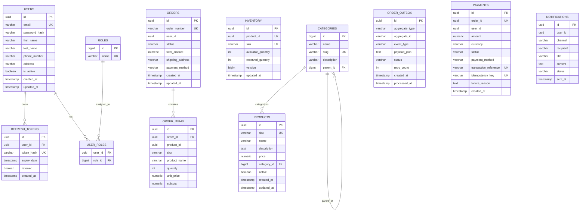
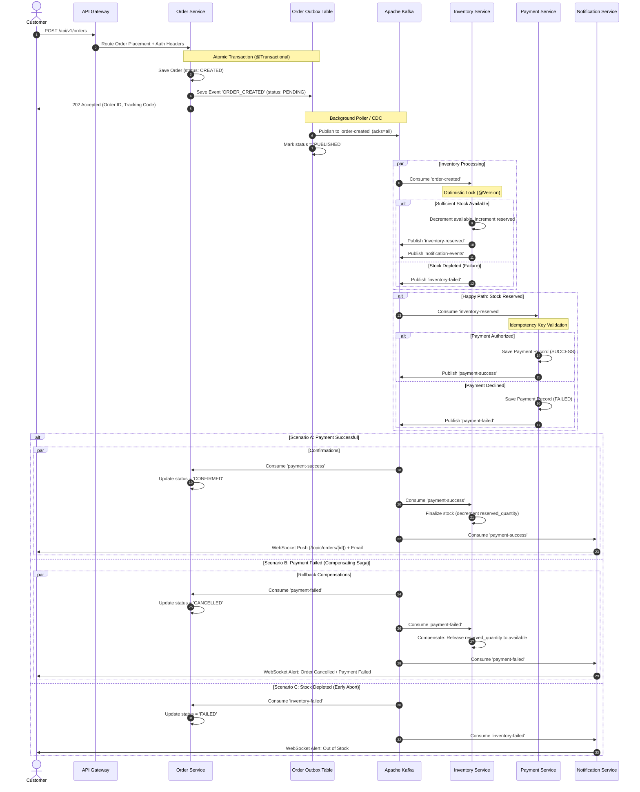
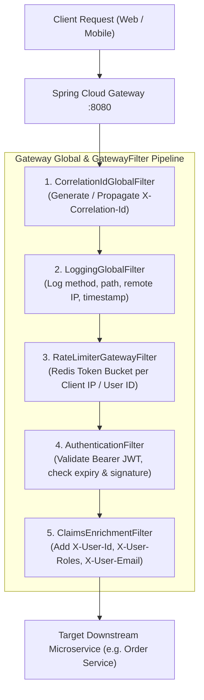
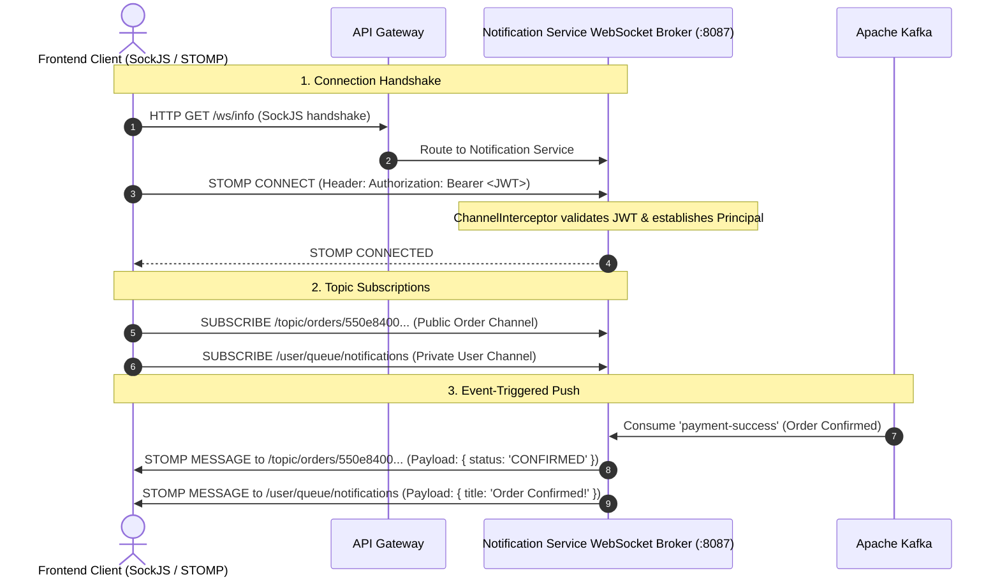
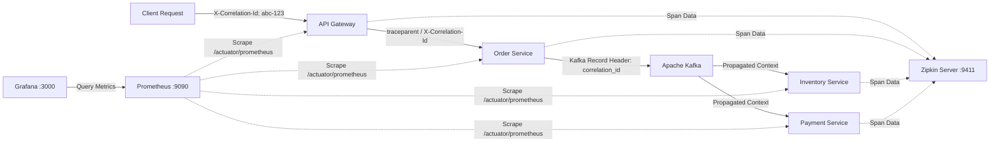

# ShopSphere – Event-Driven E-Commerce Microservices Platform

## Phase 1: High-Level and Low-Level System Architecture Specification

---

### 1. Executive Summary & Architectural Tenets

**ShopSphere** is an enterprise-grade, distributed, event-driven e-commerce platform engineered using Java 21, Spring Boot 3.3.x, Spring Cloud 2023.x, Apache Kafka, PostgreSQL, Redis, and Docker.

#### Core Architectural Tenets

1. **Domain-Driven Design (DDD) & Bounded Contexts:** Every microservice encapsulates a distinct business domain with its own data store (Database-per-Service). Direct cross-database joins are prohibited.
2. **Event-Driven Architecture (EDA) & Eventual Consistency:** Cross-service transaction workflows rely on asynchronous message queues (Apache Kafka) utilizing the Saga Pattern. Synchronous HTTP (OpenFeign) is strictly reserved for non-mutating queries or instant read snapshots.
3. **Zero-Trust Edge Security:** The API Gateway acts as the policy enforcement point, terminating perimeter traffic, validating JWTs, rate-limiting malicious bursts, and forwarding sanitized identity claims (`X-User-Id`, `X-User-Roles`) to downstream services.
4. **Resilience & Fault Isolation:** Failures in auxiliary services (e.g., Notification or Payment) must never cascade to core catalog browsing or order placement. Circuit breakers, bulkheads, rate limiters, and dead-letter queues safeguard system availability.
5. **Full Observability & Idempotency:** Every transaction carries a distributed Correlation ID (`X-Correlation-Id`), enabling seamless end-to-end tracing through Micrometer, Zipkin, and Prometheus. All event consumers enforce strict idempotency to handle network retries gracefully.

---

### 2. High-Level System Architecture

```mermaid
flowchart TD
    subgraph Clients["Client Layer"]
        SPA["Single Page App (React/Vue)"]
        Mobile["Mobile App (Android/iOS)"]
        AdminWeb["Admin Portal"]
    end

    subgraph Perimeter["Perimeter & Edge Gateway"]
        APIGW["Spring Cloud API Gateway\n:8080\n(JWT Validation, Rate Limiter, CORS, Routing)"]
        Eureka["Eureka Discovery Server\n:8761\n(Service Registry & Health Check)"]
        ConfigServer["Spring Cloud Config Server\n:8888\n(Centralized Environment Config)"]
    end

    subgraph Services["Core Microservices Layer"]
        UserService["User Service\n:8081\n(Auth, RBAC, Profiles)"]
        ProductService["Product Service\n:8082\n(Catalog, Search, Categories)"]
        InventoryService["Inventory Service\n:8083\n(Stock Reservation, Optimistic Lock)"]
        CartService["Cart Service\n:8084\n(Shopping Cart, Session State)"]
        OrderService["Order Service\n:8085\n(Order Lifecycle, Saga Initiator)"]
        PaymentService["Payment Service\n:8086\n(Idempotent Mock Gateway)"]
        NotificationService["Notification Service\n:8087\n(Email Dispatch, WebSocket STOMP)"]
    end

    subgraph DataStorage["Persistence Layer (Database-per-Service)"]
        UserDB[("user_db\nPostgreSQL")]
        ProductDB[("product_db\nPostgreSQL")]
        InventoryDB[("inventory_db\nPostgreSQL")]
        CartRedis[("cart_cache\nRedis:6379")]
        OrderDB[("order_db\nPostgreSQL")]
        PaymentDB[("payment_db\nPostgreSQL")]
        NotificationDB[("notification_db\nPostgreSQL")]
    end

    subgraph Messaging["Distributed Event Bus"]
        Kafka["Apache Kafka Cluster\n:9092\n(Topics: order-created, inventory-reserved, payment-success)"]
        KafkaUI["Kafka UI\n:8090"]
    end

    subgraph Observability["Observability & Tracing"]
        Zipkin["Zipkin / OpenTelemetry\n:9411\n(Distributed Tracing)"]
        Prometheus["Prometheus\n:9090\n(Metrics Collector)"]
        Grafana["Grafana\n:3000\n(Visualization)"]
    end

    %% Client Access
    Clients -->|HTTPS REST| APIGW
    Clients -.->|WSS STOMP /ws| NotificationService

    %% Perimeter to Microservices
    APIGW --> UserService
    APIGW --> ProductService
    APIGW --> InventoryService
    APIGW --> CartService
    APIGW --> OrderService
    APIGW --> PaymentService
    APIGW --> NotificationService

    %% Microservices to Storage
    UserService --> UserDB
    ProductService --> ProductDB
    InventoryService --> InventoryDB
    CartService --> CartRedis
    OrderService --> OrderDB
    PaymentService --> PaymentDB
    NotificationService --> NotificationDB

    %% Kafka Integration
    OrderService -->|Publish Events| Kafka
    InventoryService <-->|Consume/Publish| Kafka
    PaymentService <-->|Consume/Publish| Kafka
    OrderService <--|Consume Saga Updates| Kafka
    NotificationService <--|Consume Events| Kafka

    %% Observability Scrape
    Services -.->|Actuator Metrics| Prometheus
    Services -.->|Traces| Zipkin
    APIGW -.->|Metrics & Traces| Prometheus
```

---

### 3. Microservice Bounded Contexts & Technical Stack

| Microservice | Port | Domain Responsibilities | Database / Cache | Tech Stack Details |
| :--- | :--- | :--- | :--- | :--- |
| **Config Server** | 8888 | Centralized configuration management for all environments (`native` profile). | File System / Classpath | Spring Cloud Config Server |
| **Discovery Server** | 8761 | Dynamic service registration, heartbeat health tracking, peer routing. | In-Memory Registry | Netflix Eureka Server |
| **API Gateway** | 8080 | SSL Termination, CORS policy, JWT validation, Redis rate limiter (Token Bucket), request routing. | Redis (Rate Limiter cache) | Spring Cloud Gateway, Reactive WebFlux |
| **User Service** | 8081 | Identity management, registration, login, Refresh Token Rotation (RTR), RBAC (`ROLE_CUSTOMER`, `ROLE_ADMIN`). | PostgreSQL (`user_db`) | Spring Security, JJWT, BCrypt, Flyway, JPA |
| **Product Service** | 8082 | Product catalog, hierarchy, GIN full-text search, Redis read cache, admin product lifecycle. | PostgreSQL (`product_db`) + Redis | Spring Data JPA, Redis Cache, Flyway |
| **Inventory Service** | 8083 | Real-time stock reservation, JPA `@Version` optimistic locking, Saga step 2 execution & compensation. | PostgreSQL (`inventory_db`) | Spring Data JPA, Kafka Consumer/Producer, Flyway |
| **Cart Service** | 8084 | In-memory shopping cart sessions (`cart:{userId}`), OpenFeign product verification, 72h sliding TTL. | Redis (`cart_cache`) | Spring Data Redis, OpenFeign, Resilience4j |
| **Order Service** | 8085 | Order creation, Transactional Outbox pattern, Saga coordination, state machine (`PENDING` $\rightarrow$ `CONFIRMED`/`CANCELLED`). | PostgreSQL (`order_db`) | Spring Data JPA, Kafka, OpenFeign, Flyway |
| **Payment Service** | 8086 | Idempotent transaction processing, mock payment provider integration, webhook simulation, payment auditing. | PostgreSQL (`payment_db`) | Spring Data JPA, Kafka |
| **Notification Service** | 8087 | Asynchronous email dispatch, STOMP WebSocket broker endpoint `/ws`, private user channels (`/user/queue/notifications`). | PostgreSQL (`notification_db`) | Spring WebSocket, STOMP, Mail, Kafka |

---

### 4. Service-to-Service Communication Design

#### Synchronous vs. Asynchronous Decision Matrix

| Communication Type | Protocol | Technology | Use Case | Rationale & Trade-offs |
| :--- | :--- | :--- | :--- | :--- |
| **Synchronous (Request-Response)** | HTTP/REST | **OpenFeign + Resilience4j** | Cart Service fetching product price snapshot before checkout; Order Service fetching customer delivery address snapshot. | Needed when the client immediately requires an atomic read-only data payload to proceed. *Trade-off: Runtime coupling. Mitigated using Circuit Breakers, timeouts, and fallbacks.* |
| **Asynchronous (Event-Driven)** | Binary TCP | **Apache Kafka** | Order creation, stock reservation, payment execution, status updates, notifications. | High throughput, temporal decoupling, failure resilience. Sender does not wait; consumers process at their own pace. |

#### Resilience4j Resiliency Strategy

```mermaid
flowchart LR
    Caller["Order Service"] -->|Feign Call| CB["Resilience4j Circuit Breaker"]
    CB -->|Closed (Normal)| Target["Product Service"]
    CB -->|Open (Tripped)| Fallback["Fallback Method\n(Return Cached / Degraded Response)"]
    CB -->|Half-Open| Probe["Canary Requests (Test Recovery)"]
```

- **Circuit Breaker:** Sliding window of 10 requests. If failure rate > 50%, circuit transitions from `CLOSED` to `OPEN` for 10 seconds.
- **Time Limiter:** Max execution duration = 2.5 seconds. Requests exceeding this threshold fail fast.
- **Retry:** Max 3 attempts with exponential backoff (`initialInterval = 500ms`, `multiplier = 2`), only on transient errors (`IOException`, `SocketTimeoutException`). Never retry on 4xx Client Errors.
- **Bulkhead:** Max 20 concurrent Feign calls to isolate resource starvation.

---

### 5. PostgreSQL Database Design & Microservice Schemas



#### Detailed Indexing & Integrity Rules

1. **`user_db.users`**: Unique B-tree index on `LOWER(email)`.
2. **`product_db.products`**: B-tree index on `(category_id, active)`, unique index on `sku`. Full-text search GIN index on `to_tsvector('english', name || ' ' || description)`.
3. **`inventory_db.inventory`**: Unique index on `product_id`. Optimistic locking via `version BIGINT NOT NULL DEFAULT 0`.
4. **`order_db.orders`**: Composite index on `(user_id, created_at DESC)`. Unique index on `order_number`.
5. **`order_db.order_outbox`**: Partial index on `(status, created_at)` where `status = 'PENDING'` for high-speed Transactional Outbox polling.
6. **`payment_db.payments`**: Unique index on `idempotency_key` and `order_id` to prevent duplicate transaction authorization.

---

### 6. Kafka Event-Driven Architecture & Event Contracts

#### Kafka Topics Catalog

| Topic Name | Partitions | Replication | Cleanup Policy | Key Strategy | Retention |
| :--- | :--- | :--- | :--- | :--- | :--- |
| `order-created` | 6 | 3 | delete | `orderId` | 7 Days |
| `inventory-reserved` | 6 | 3 | delete | `orderId` | 7 Days |
| `inventory-failed` | 6 | 3 | delete | `orderId` | 7 Days |
| `payment-requested` | 6 | 3 | delete | `orderId` | 7 Days |
| `payment-success` | 6 | 3 | delete | `orderId` | 7 Days |
| `payment-failed` | 6 | 3 | delete | `orderId` | 7 Days |
| `order-confirmed` | 6 | 3 | delete | `orderId` | 7 Days |
| `order-cancelled` | 6 | 3 | delete | `orderId` | 7 Days |
| `notification-events` | 6 | 3 | delete | `userId` | 3 Days |
| `shopsphere.DLT` | 3 | 3 | compact,delete | `eventId` | 30 Days |

#### Standard Event Envelope Specification

All domain events conform to a strict schema wrapping the domain payload:

```json
{
  "eventId": "9b1deb4d-3b7d-4bad-9bdd-2b0d7b3dcb6d",
  "eventType": "ORDER_CREATED",
  "eventTimestamp": "2026-11-21T22:30:00Z",
  "aggregateType": "ORDER",
  "aggregateId": "550e8400-e29b-41d4-a716-446655440000",
  "correlationId": "corr-f47ac10b-58cc-4372-a567-0e02b2c3d479",
  "version": 1,
  "payload": {
    "orderId": "550e8400-e29b-41d4-a716-446655440000",
    "orderNumber": "ORD-20261121-0001",
    "userId": "123e4567-e89b-12d3-a456-426614174000",
    "totalAmount": 199.98,
    "currency": "USD",
    "items": [
      {
        "productId": "789e4567-e89b-12d3-a456-426614174111",
        "sku": "LAPTOP-PRO-15",
        "quantity": 1,
        "unitPrice": 199.98
      }
    ]
  }
}
```

#### Consumer Group Strategy & Dead Letter Topics (DLT)

```mermaid
flowchart TD
    Producer["Event Publisher"] --> Topic["Main Topic: order-created"]
    Topic --> ConsumerGroup["Consumer: InventoryService (Group: 'inventory-group')"]
    ConsumerGroup -->|Business Logic Success| Ack["Commit Offset (ACK)"]
    ConsumerGroup -->|Transient Error (DB Down)| RetryTopic["Retry Topic (Exponential Backoff: 1s, 5s, 10s)"]
    ConsumerGroup -->|Fatal Error / Schema Corrupt / Max Retries Exceeded| DLT["shopsphere.DLT\n(Alert SRE + Manual Replay)"]
```

---

### 7. Distributed Transaction Management: Order-to-Payment Saga

#### Choreography-Based Saga Implementation with Compensations



---

### 8. API Gateway Routing, Security & Cross-Cutting Architecture



---

### 9. Redis Session & Caching Architecture

#### 1. Cart Storage Strategy (Key-Value Hash)

- **Key Pattern:** `cart:{userId}`
- **Data Structure:** Redis Hash where `field = productId` and `value = JSON String (sku, name, quantity, price)`
- **TTL & Expiration:** Sliding TTL of **72 Hours** refreshed upon every cart mutation.
- **Why Redis over PostgreSQL:** Shopping carts are transient, write-intensive, and over 70% are abandoned. Storing carts in PostgreSQL causes severe table bloat, index fragmentation, and requires scheduled batch cleanups. Redis provides sub-millisecond read/write latency with automatic TTL expiration.

#### 2. Product Catalog Caching Strategy (Cache-Aside Pattern)

- **Cache Name:** `products`
- **Key Strategy:** `products::id:{id}` or `products::category:{categoryId}:page:{page}`
- **TTL:** 1 Hour with random jitter (50-70 mins) to prevent **Cache Stampede / Thundering Herd**.
- **Cache Invalidation:** Using Spring `@CacheEvict(value = "products", allEntries = true)` whenever an admin updates or deletes a product.

---

### 10. WebSocket Real-Time Notification Architecture



---

### 11. End-to-End Distributed Tracing & Observability



---

### 12. Project Phased Implementation Roadmap

```text
ShopSphere/
├── Phase 1: Architecture & Design Documents (docs/architecture/system-design.md)
├── Phase 2: Multi-Module Root & Common Library (pom.xml, shopsphere-common)
├── Phase 3: Core Infrastructure Services (config-server, discovery-server, api-gateway)
├── Phase 4: User Service & Identity (user-service, JWT RTR, Flyway, PostgreSQL)
├── Phase 5: Product & Inventory Services (product-service, inventory-service, Redis caching, @Version)
├── Phase 6: Cart Service (cart-service, Redis sessions, OpenFeign with Resilience4j)
├── Phase 7: Order Service & Transactional Outbox (order-service, Outbox poller, Saga Step 1)
├── Phase 8: Payment Service & Saga Orchestration (payment-service, Mock gateway, Compensations)
├── Phase 9: Notification Service & WebSocket (notification-service, STOMP broker, Mailer)
├── Phase 10: Observability, Metrics & Resiliency (Zipkin tracing, Prometheus scraping, Grafana dashboards)
└── Phase 11: Production Packaging, Testcontainers & Documentation (E2E Test, Docker Compose, Postman)
```

---

### 13. Senior Java Backend Architect Interview Q&A Deep Dive

#### 1. Why use Apache Kafka over RabbitMQ for the ShopSphere e-commerce backbone?

**Architectural Answer:**

- **Storage & Log Retention:** RabbitMQ is an AMQP-based message broker where messages are deleted once acknowledged. Kafka is a distributed, immutable commit log where events are retained for days. This allows new microservices (e.g., a future Analytics or Fraud Detection service) to replay historical events from offset zero without altering existing business logic.
- **Throughput & Partitioning:** Kafka utilizes partition-based horizontal scalability. By keying events on `orderId`, all events for a given order are guaranteed to hit the exact same partition, preserving strict chronological ordering without cross-worker locking.
- **Stream Processing:** Kafka integrates seamlessly with Kafka Streams for complex event processing (e.g., real-time cart abandonment detection or fraud pattern recognition).

#### 2. What is the Dual-Write Problem, and how does ShopSphere solve it?

**Architectural Answer:**

- **The Problem:** In `OrderService`, saving the order to PostgreSQL and publishing `OrderCreatedEvent` to Kafka requires two writes. If the database commit succeeds but the network drops before Kafka receives the event, the order exists but inventory is never reserved (Zombie Order). Conversely, if Kafka receives the event but the database transaction rolls back, inventory is reserved for a non-existent order.
- **The Solution (Transactional Outbox Pattern):** We write the order entity AND the domain event into an `order_outbox` table within the **same atomic database transaction (`@Transactional`)**. A background worker or CDC tool (Debezium / Spring Scheduled Poller) reads pending outbox records, publishes them to Kafka with acknowledgments (`acks=all`), and marks them as `PUBLISHED`. This guarantees **At-Least-Once Delivery**.

#### 3. How do we prevent overselling under high concurrency in the Inventory Service?

**Architectural Answer:**

- **Optimistic Locking (`@Version`):** We use a `version` column managed by JPA. When two concurrent requests attempt to reserve the last unit of a product, both read `version = 1`. The first request updates the quantity and increments `version = 2`. The second request fails with `OptimisticLockException` because the row version has changed.
- **Why not Pessimistic Locking (`SELECT FOR UPDATE`)?** Pessimistic locking holds row-level locks on the database, reducing throughput and introducing deadlock risks during flash sales. Optimistic locking avoids database locking overhead. Combined with exponential backoff retries, it provides superior throughput under read-heavy and bursty workloads.

#### 4. How is Idempotency guaranteed across event consumers?

**Architectural Answer:**

- Because Kafka guarantees **At-Least-Once Delivery**, network hiccups can cause duplicate event consumption.
- In `PaymentService` and `InventoryService`, every event envelope contains an immutable `eventId` and `correlationId`. Consumers execute an atomic check-and-insert into a `processed_events` table within their local database transaction:

  ```sql
  INSERT INTO processed_events (event_id, handler_name, processed_at)
  VALUES ('9b1deb4d-...', 'InventoryReservedHandler', NOW());
  ```

- If a duplicate event arrives, the database unique constraint raises a collision (`DataIntegrityViolationException`), and the consumer immediately acknowledges (commits) the message without re-processing.

#### 5. Why Choreography-based Saga over Orchestration-based Saga for this project?

**Architectural Answer:**

- In **Choreography**, each microservice listens to events from other services and independently decides its actions and compensations. There is no central orchestrator as a single point of failure. This keeps services loosely coupled and lightweight.
- For an enterprise e-commerce platform with 4–5 steps (Order -> Inventory -> Payment -> Notification), choreography provides optimal simplicity and high throughput. (If the workflow exceeded 10+ complex branching steps, an Orchestration engine like Temporal or Camunda would be evaluated).
